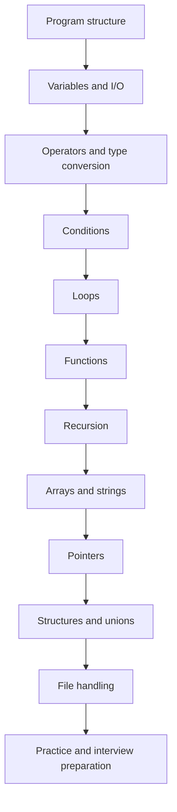

<p align="center">
  <a href="https://github.com/Devputta/Drafts-might-be-needed-/blob/main/LOGO/Gemini_Generated_Image_1ppnm1ppnm1ppnm1%20(1).jfif" target="_blank" rel="noopener noreferrer">
    
  </a>
</p>

<h1 align="center">C Programming — Beginner Learning Notes</h1>

<p align="center"><strong>Learn the concept. Write the program. Trace the output. Build the logic.</strong></p>

<p align="center">
  <a href="https://github.com/Devputta/Cprogramming">View the repository on GitHub</a>
</p>

<p align="center">
  
  
  
  
</p>

---

## About this repository

This repository is a practical C programming learning workspace. It contains C source-code exercises in the repository itself and a separate documentation collection for understanding the concepts behind those programs.

The notes are written for beginners and use a consistent learning pattern:

1. **Concept** — what the topic means and why it is used.
2. **Syntax** — the common C syntax.
3. **Example** — a small, readable program.
4. **Output** — what the program prints.
5. **Trace** — how important values change step by step.
6. **Common mistakes** — errors beginners often make.
7. **Practice** — exercises to check understanding.

> The documentation ZIP accompanying this README contains Markdown notes only. It intentionally does **not** include or replace the existing `.c` source files or executable files in the repository.

## Start here

| Step | Topic | Notes |
|---|---|---|
| 01 | C overview and program structure | [01 — Getting Started](docs/topics/01-getting-started.md) |
| 02 | Variables, constants and data types | [02 — Variables and Data Types](docs/topics/02-variables-data-types.md) |
| 03 | Input, output and format specifiers | [03 — Input and Output](docs/topics/03-input-output.md) |
| 04 | Operators and expressions | [04 — Operators](docs/topics/04-operators.md) |
| 05 | Type conversion and casting | [05 — Type Conversion](docs/topics/05-type-conversion.md) |
| 06 | Conditions and decision making | [06 — Conditions](docs/topics/06-conditions.md) |
| 07 | `switch` statement | [07 — Switch](docs/topics/07-switch.md) |
| 08 | Loops: `for`, `while`, `do while` | [08 — Loops](docs/topics/08-loops.md) |
| 09 | Nested loops and pattern logic | [09 — Nested Loops](docs/topics/09-nested-loops-patterns.md) |
| 10 | Functions and parameter passing | [10 — Functions](docs/topics/10-functions.md) |
| 11 | Recursion | [11 — Recursion](docs/topics/11-recursion.md) |
| 12 | Arrays | [12 — Arrays](docs/topics/12-arrays.md) |
| 13 | Strings and string library | [13 — Strings](docs/topics/13-strings.md) |
| 14 | Pointers | [14 — Pointers](docs/topics/14-pointers.md) |
| 15 | Structures and unions | [15 — Structures and Unions](docs/topics/15-structures-unions.md) |
| 16 | File handling | [16 — File Handling](docs/topics/16-file-handling.md) |
| 17 | Problem solving and debugging | [17 — Problem Solving](docs/topics/17-problem-solving.md) |

### Interview preparation

- [C interview questions with answers, code and output traces](docs/interview/c-interview-questions.md)
- [Practice problems by topic](docs/practice/practice-problems.md)
- [Output tracing worksheet](docs/practice/output-tracing.md)
- [Glossary of C terms](docs/references/glossary.md)

## Learning path



## Compile and run a C program

Install a C compiler such as GCC. Check that it is available:

```bash
gcc --version
```

Compile a file:

```bash
gcc filename.c -o program
```

Run on Windows Command Prompt:

```cmd
.\program.exe
```

Run on Linux or macOS:

```bash
./program
```

For warnings and useful diagnostics, prefer:

```bash
gcc -std=c11 -Wall -Wextra -Wpedantic filename.c -o program
```

## How to use these notes effectively

- Read one topic at a time; do not try to memorize everything at once.
- Type each example yourself instead of only copying it.
- Predict the output before running the program.
- Trace variables in a table when loops or recursion are involved.
- Change input values and test boundary cases.
- Compile with warnings enabled and fix warnings.
- Complete the practice questions before moving to the next topic.

## Important learning and safety notes

- Examples are educational and should be tested with a C11-compatible compiler.
- Some operations, such as out-of-bounds array access, use of uninitialized variables, invalid pointer dereferencing, and signed integer overflow, can cause undefined behavior. Do not treat their output as predictable.
- The examples use small inputs to make the logic easy to follow. Real programs should validate user input and handle errors.
- “All possible interview questions” is not a finite set. The interview guide is a broad, curated preparation set and should be expanded through practice and project experience.

## Credits and learning references

These notes are an independently written beginner-friendly study companion. The following learning resources are acknowledged as references used for learning and topic guidance:

- **Apna College — C Programming video:** [Watch the YouTube video](https://youtu.be/irqbmMNs2Bo?si=2D9ASW0Pfucp8ohg)
- **Apna College — shared study notes:** [Open the Google Drive notes folder](https://drive.google.com/drive/folders/1SEfL7Yw3nJfVLToz9MAuAm2_NoCCk1qD)

All credit for the original video and shared notes belongs to their respective creators/owners. This repository is not affiliated with or endorsed by Apna College. The explanations and examples in this documentation are rewritten for this repository; the linked resources remain the original materials.

## Repository owner

**DevPutta · Vibe Coder**

- GitHub: [@Devputta](https://github.com/Devputta)
- Repository: [Cprogramming](https://github.com/Devputta/Cprogramming)

---

<p align="center"><strong>Understand the logic, not just the syntax.</strong></p>
