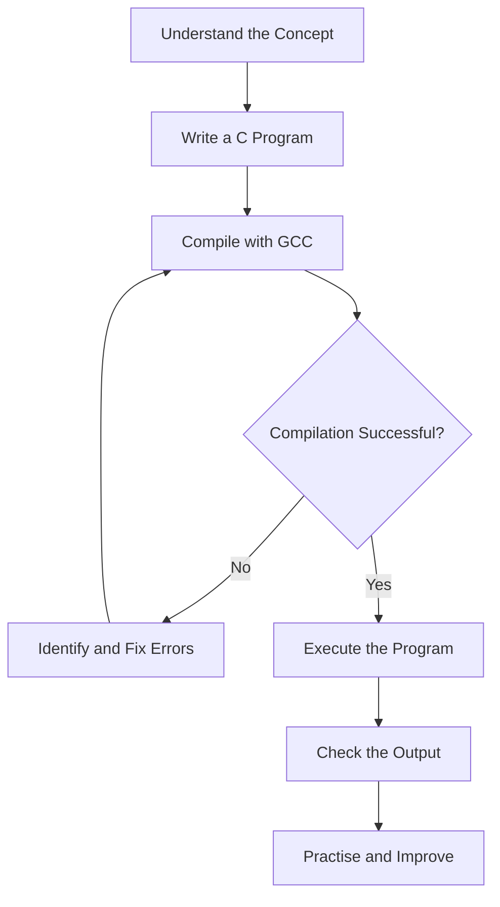

 <p align="center">
  <a href="https://github.com/Devputta/Cprogramming">
    
  </a>
</p>

<h1 align="center">C Programming</h1>

<p align="center">
  <strong>Learn the fundamentals. Write code. Build logic.</strong>
</p>

<p align="center">
  A practical collection of C programming exercises and examples created while learning the C language, exploring programming fundamentals, and developing problem-solving skills.
</p>

<p align="center">
  
  
  
  
  
</p>

<p align="center">
  <a href="#overview">Overview</a> ·
  <a href="#topics">Topics</a> ·
  <a href="#program-examples">Examples</a> ·
  <a href="#installation">Installation</a> ·
  <a href="#compiling-and-running">Run Programs</a> ·
  <a href="#learning-approach">Learning Approach</a>
</p>

---

## Overview

C Programming is a hands-on learning repository containing C source code written while exploring the fundamentals of the C programming language.

The purpose of this repository is to understand how programs work, learn the syntax of C, practise input and output operations, and gradually improve logical thinking through small programming exercises.

Rather than focusing only on theory, this repository emphasizes writing, compiling, executing, and understanding programs.

### Learning objectives

- Understand the basic structure of a C program.
- Work with variables and data types.
- Learn standard input and output operations.
- Understand operators and expressions.
- Practise taking input from users.
- Develop basic mathematical and logical operations.
- Identify and fix common programming errors.
- Become comfortable using GCC and VS Code.

## Topics

The repository is organized around practical learning.

| Topic | Concepts |
|---|---|
| C Fundamentals | Program structure, header files, `main()` |
| Variables | Declaration, initialization, naming |
| Data Types | `int`, `char`, `float`, `double` |
| Output | `printf()` |
| Input | `scanf()` |
| Format Specifiers | `%d`, `%c`, `%f`, `%s` |
| Operators | Arithmetic and expressions |
| Basic Programs | Addition and other simple calculations |

Additional topics can be added as learning progresses.

## Program Examples

Some examples of the exercises covered during the learning process:

### 1. Hello World

A basic program demonstrating the structure of a C application and the use of `printf()`.

```c
#include <stdio.h>

int main()
{
    printf("Hello World");

    return 0;
}
```

### 2. Variables and Data Types

Understanding how variables store different types of values.

```c
#include <stdio.h>

int main()
{
    int age = 10;
    char grade = 'A';
    float pi = 3.14;

    printf("Age: %d\n", age);
    printf("Grade: %c\n", grade);
    printf("Pi: %f\n", pi);

    return 0;
}
```

### 3. User Input

Using `scanf()` to accept information from the user.

```c
#include <stdio.h>

int main()
{
    int age;

    printf("Enter your age: ");
    scanf("%d", &age);

    printf("My age is %d\n", age);

    return 0;
}
```

### 4. Addition of Two Numbers

A simple arithmetic program using user input and variables.

```c
#include <stdio.h>

int main()
{
    int a, b;

    printf("Enter the first number: ");
    scanf("%d", &a);

    printf("Enter the second number: ");
    scanf("%d", &b);

    int sum = a + b;

    printf("Sum: %d\n", sum);

    return 0;
}
```

## Installation

### Requirements

- Windows, Linux, or macOS.
- GCC compiler.
- Visual Studio Code or another C-compatible editor.
- Basic command-line knowledge.

### Install GCC on Windows

MSYS2 provides a convenient way to install GCC on Windows.

1. Download and install [MSYS2](https://www.msys2.org/).
2. Open the MSYS2 UCRT64 terminal.
3. Install GCC:

```bash
pacman -S --needed mingw-w64-ucrt-x86_64-gcc
```

4. Add the following directory to your Windows PATH:

```text
C:\msys64\ucrt64\bin
```

5. Restart VS Code and verify:

```cmd
gcc --version
```

### Clone the repository

```bash
git clone https://github.com/Devputta/Cprogramming.git
```

Navigate into the project:

```bash
cd Cprogramming
```

## Compiling and Running

C programs must be compiled before executing them.

### Compile a program

For example, if your source file is `main.c`:

```cmd
gcc main.c -o main.exe
```

### Execute on Windows CMD

```cmd
.\main.exe
```

### Execute on Linux or macOS

```bash
gcc main.c -o main
./main
```

### Important compiler notes

- Compile the correct `.c` file before executing it.
- Use different executable names for different programs.
- Check compilation errors before running.
- Do not confuse an older executable with the latest source code.
- Use `stdio.h` for standard input and output functions.

## Understanding Format Specifiers

Format specifiers tell `printf()` and `scanf()` what kind of data is being handled.

| Specifier | Data type | Example |
|---|---|---|
| `%d` | Integer | `int age = 20;` |
| `%c` | Character | `char grade = 'A';` |
| `%f` | Floating-point | `float pi = 3.14;` |
| `%lf` | Double in `scanf()` | `double value;` |
| `%s` | String | `char name[] = "Dev";` |

## Learning Approach

The repository follows a practical learning process:



The goal is to understand the code rather than simply copy and execute it.

## Common Mistakes to Avoid

| Mistake | Correct approach |
|---|---|
| Using `%c` for a string | Use `%s` |
| Using single quotes for strings | Use double quotes |
| Forgetting `&` in `scanf()` for ordinary variables | Pass the variable address |
| Running an old executable | Recompile the latest source |
| Using `./program.exe` in CMD | Use `.\program.exe` |
| Forgetting semicolons | End C statements with `;` |

## Development Environment

| Tool | Purpose |
|---|---|
| C | Programming language |
| GCC | C compiler |
| Visual Studio Code | Code editor |
| Windows CMD | Compilation and execution |

## Repository Progress

This repository will grow as more C programming concepts and exercises are explored.

Future learning areas may include:

- [ ] Conditional statements
- [ ] Loops
- [ ] Functions
- [ ] Arrays
- [ ] Strings
- [ ] Pointers
- [ ] Structures and unions
- [ ] Recursion
- [ ] File handling
- [ ] Data structures and algorithms

These are learning goals, not claims that the topics are already implemented.

## Contributing

Suggestions, corrections, and improvements are welcome.

1. Fork the repository.
2. Create a new branch.
3. Add or improve a C program.
4. Test the program using a C compiler.
5. Submit a pull request with a clear description.

Keep programs readable, focused, and easy for beginners to understand.

## License

Refer to the repository's `LICENSE` file for licensing information.

---

<p align="center">
  <strong>C Programming</strong>
</p>

<p align="center">
  Learn by writing. Improve by practising. Understand by building.
</p>

<p align="center">
  <a href="https://github.com/Devputta/Cprogramming">View Repository</a>
</p>
